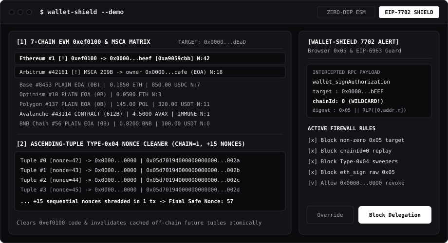

# evm-wallet-shield




Made this on 3am ginger chai after watching folks lose wallets to blind signatures.

Not a bug bhai, free feature: EIP 7702 literally lets a normal wallet wear smart contract clothes. One bad click on a fake airdrop page and your wallet starts forwarding tokens across seven chains faster than you can unplug WiFi.

## what is this

* **7 chain wallet scanner**: Checks Ethereum, Arbitrum, Base, Optimism, Polygon, Avalanche, and BNB Chain in one go.
* **Hidden sweeper finder**: Spots active `0xef0100` code stuck on your wallet and flags token drain functions inside it.
* **Smart wallet owner check**: Checks if a safe looking smart wallet is actually owned by one plain hot wallet.
* **Bulk nonce cleaner**: Burns 15+ sequential nonces in one transaction so old leaked signatures die together.
* **Browser signer guard**: Wraps MetaMask, Rabby, and other wallets to block shady `0x05` signing popups while still allowing `0x0000...0000` cleanup transactions.
* **Zero package bloat**: Pure Node 18+ with zero external libraries. When i wrote the RLP byte packer only me and bhagwan knew how it worked, now only bhagwan knows (thankfully the unit tests pass).

## run it in 60 sec

No heavy install step. Clone it and run the offline demo right away:

```bash
git clone https://github.com/LevCodeLab/evm-wallet-shield.git
cd evm-wallet-shield

# Run instant offline 7 chain demo on test address 0x0000...dEaD
npm run demo

# Scan any live 0x wallet across all 7 chains and plan 15 nonce cleanups
node src/cli.mjs 0x000000000000000000000000000000000000dEaD 15

# Run all unit tests
npm test
```

## quick code usage

Drop the signer guard into any web app before wallet scripts run:

```js
import { installFirewall } from "evm-wallet-shield/firewall";
import { buildAscendingNonceShredPlan } from "evm-wallet-shield/rlp";

installFirewall(window);

const plan = buildAscendingNonceShredPlan(1, 42, 15);
console.log(plan.finalSafeNonce); // 57
```

## how to edit and customize

| File | What to change here |
| :--- | :--- |
| `src/rlp.mjs` | Byte encoder and sequential nonce cleanup builder. Edit this to raise max nonce batch size. |
| `src/scanner.mjs` | Chain RPC list, USDC/USDT addresses, sweeper function checks, and offline demo data. Put your own RPC URLs here if public nodes get busy. |
| `src/cli.mjs` | Terminal flags and ASCII table printer. |
| `browser/wallet-shield-firewall.js` | Browser wallet guard for `0x05` signatures and `chainId 0` replay tricks. Pass your own `confirmFn` to show a custom popup. |
| `api/shield.ts` | Ready to deploy Edge HTTP route (`GET` or `POST`) for web apps. |
| `docs/architecture.md` | Plain notes on how `0xef0100` wallet hijacks and sequential nonce burning work. |
| `test/wallet-shield.test.mjs` | Unit tests for byte math, mocked 7 chain scans, and browser wallet blocking. |

## license

MIT License. Copyright (c) 2026 LevCodeLab. See [LICENSE](./LICENSE).
